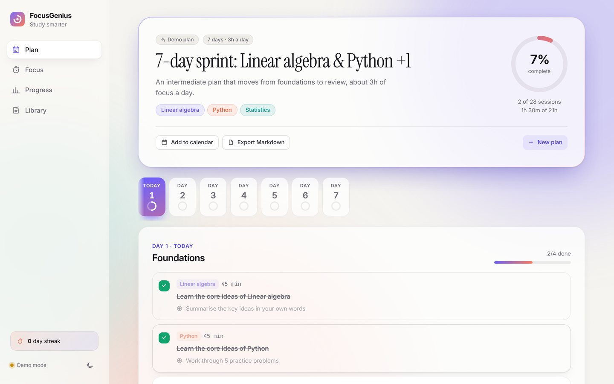

# FocusGenius

FocusGenius turns the topics you want to learn into a day-by-day study plan, then helps you follow it with a focus timer and progress tracking.



## Features

- **AI study plans.** Add topics, hours per day, plan length, your level and an optional goal. The plan comes back as days of focused sessions, each with one checkable objective.
- **Demo mode.** Without an OpenAI key, the server builds a plan locally, so the app always works. If the AI call fails, it falls back to the same planner.
- **Focus timer.** Pomodoro-style Focus (25m), Deep work (50m), Short and Long breaks. Start it from any session to link it, and the session is ticked off when the block ends. It has a full-screen mode, a soft chime, auto-starting breaks, the countdown in the tab title, and keyboard shortcuts (`Space` start or pause, `F` full screen).
- **Progress.** Total focus time, day streak, sessions done, a 14-day chart and time per topic.
- **Library and export.** Plans and progress are saved in your browser. Export any plan to your calendar (`.ics`) or to Markdown.
- **Light and dark themes** that follow your system, with a toggle. Works on phones too.

## Run it

You need Node.js 18 or newer.

```bash
npm run setup     # installs root, backend and frontend dependencies
npm run dev       # starts the API on :5500 and the web app on :5173
```

Open http://localhost:5173.

### Turn on AI plans (optional)

```bash
cp backend/.env.example backend/.env
# then set OPENAI_API_KEY in backend/.env (OPENAI_MODEL defaults to gpt-4o-mini)
```

The sidebar shows **AI connected** when the key is picked up, and **Demo mode** when it isn't.

## Project layout

```
backend/    Express API: POST /api/create-schedule, GET /api/health
  planner.js       input validation, prompt, AI response cleanup, offline planner
frontend/   React 19 + Vite + Framer Motion
  src/styles.css   design tokens (colors, type, radii, shadows) and components
  src/components/  PlanForm, PlanView, FocusTimer, Progress, Library
  src/lib/         timer, storage, stats and export helpers
```

## Scripts

| Command | What it does |
| --- | --- |
| `npm run dev` | API and web app together, with reload |
| `npm test` | Backend unit tests (`node --test`) |
| `npm run build` | Production build of the web app into `frontend/dist` |

For a deployed frontend that talks to an API on another host, set `VITE_API_URL` at build time.
